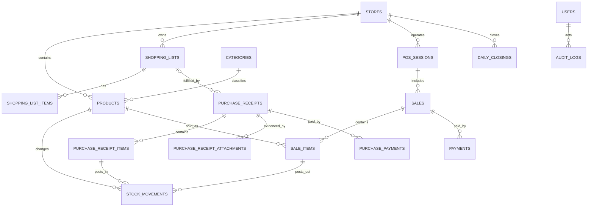

# 07 — Logical Data Model & Database Constraints

**Target:** PostgreSQL, single database, modular schema ownership. Desain mengikuti kebutuhan MVP; tabel tambahan boleh muncul bila diperlukan setelah review use case. Semua bisnis domain menggunakan `store_id` walaupun awalnya hanya satu outlet.

## 1. Konvensi

- ID: UUID/ULID konsisten; FK dan indeks harus eksplisit.
- Waktu: `created_at`, `updated_at` bertipe `timestamptz` UTC; waktu lokal untuk UI dan `business_date` menggunakan `Asia/Jakarta`.
- Uang transaksi IDR tanpa pecahan: `BIGINT` nonnegatif kecuali signed delta eksplisit; cost/quantity menggunakan `NUMERIC(18,6)` dan rounding saat posting.
- FK mandatory pada sumber posted; `metadata JSONB NOT NULL DEFAULT '{}'` untuk field tambahan non-esensial.
- `status` enum/check di database; kolom audit actor yang penting tidak boleh diedit oleh client.
- Soft archive pada master; ledger dan dokumen posted immutable secara bisnis, correction via reversal.
- Semua nomor dokumen unik dalam `store_id` dan jenis dokumen; internal ID tetap primary key.

## 2. Core table catalog

| Tabel | Kolom minimum (selain PK/timestamps) | Catatan/constraint |
| --- | --- | --- |
| `stores` | code, name, timezone, active | Satu store seed awal |
| `users` | email/username, password_hash, role_id, active | Store membership perlu divalidasi; MVP `store_id` pada users jika hanya satu store per user |
| `roles` | code, name, active | OWNER/ADMIN/CASHIER |
| `role_permissions` | role_id, resource, action, granted | Unique role+resource+action |
| `categories` | store_id, name, parent_id?, active | Parent opsional, tidak wajib tree |
| `products` | store_id, category_id, sku, barcode?, name, unit, selling_price, min_stock, is_active, metadata | `UNIQUE(store_id, sku)` |
| `shopping_lists` | store_id, number, status, created_by, note, requested_at | Draft/active/cancelled |
| `shopping_list_items` | shopping_list_id, product_id?, free_text_name?, requested_qty, unit, note | product atau free text wajib terisi |
| `purchase_receipts` | store_id, shopping_list_id?, number, status, supplier_name?, subtotal, total, created_by (Cashier), submitted_at?, approved_by?, approved_at?, rejected_by?, rejected_at?, rejection_reason?, posted_at? | Receipt SUBMITTED hanya posting stock saat APPROVED_POSTED |
| `purchase_receipt_items` | receipt_id, shopping_list_item_id?, product_id, accepted_qty, purchased_unit_cost, landed_unit_cost, proposed_selling_price?, line_total, note | Qty/harga beli diinput Cashier, harga jual baru berlaku setelah approve |
| `purchase_receipt_attachments` | receipt_id, store_id, storage_key, file_name, mime_type, byte_size, checksum, uploaded_by, uploaded_at, is_active | Bukti foto/PDF privat; minimal 1 attachment aktif sebelum submit/approve |
| `purchase_payments` | receipt_id, amount, source_account, paid_at, reference?, created_by, status | Terpisah dari stok masuk |
| `stock_movements` | store_id, product_id, source_type, source_line_id, movement_kind, signed_qty, unit_cost_snapshot, posted_at, posted_by | Append-only; idempotent unique source+kind |
| `sales` | store_id, session_id, number, status, subtotal, discount_total, total, created_by, paid_at?, voided_at? | Satu transaksi POS |
| `sale_items` | sale_id, product_id, product_name_snapshot, sku_snapshot, qty, unit_price, discount, line_total, unit_cogs_snapshot | Simpan snapshot historis |
| `payments` | sale_id, method, amount, status, verified_by?, verified_at?, merchant_reference?, settlement_status?, settled_at?, fee_amount? | Multiple future-ready; MVP satu confirmed method |
| `pos_sessions` | store_id, cashier_id, status, opened_at, opening_cash, submitted_at?, counted_cash?, expected_cash?, variance?, approved_by?, approved_at? | Satu sesi aktif/cashier/store |
| `cash_movements` | store_id, session_id?, direction, category, amount, source_type?, source_id?, reason, created_by, occurred_at | Manual cash IN/OUT, expense/purchase/refund link |
| `expenses` | store_id, category, description, amount, payment_source, expense_date, created_by, receipt_reference? | Non-inventory expense |
| `daily_closings` | store_id, business_date, status, total_cash, total_qris, expected_cash, counted_cash, variance, submitted_by, approved_by?, approved_at?, notes | Unique store+business_date (MVP) |
| `audit_logs` | store_id?, actor_id, action, entity, entity_id, before_json?, after_json?, reason?, correlation_id?, created_at | Append-only, sanitized |

**Catatan RBAC multi-store:** jika satu user dapat mengakses banyak toko, ubah relasi `users.store_id` menjadi `user_store_memberships(user_id, store_id, role_id)` dan jangan mengandalkan satu global `role_id`. Rekomendasi desain sekarang: gunakan membership meski hanya satu store agar migrasi tidak menyulitkan; ini menambah satu tabel dari katalog minimal.

**Tabel proyeksi opsional:** `inventory_balances(store_id, product_id, on_hand, avg_unit_cost, version)` untuk performa dan locking; bukan source of truth tanpa rekonsiliasi terhadap ledger. **P1:** `stock_counts`, `stock_count_items`, `suppliers`, `customers`, `bank_settlements`, `refunds`.

## 3. Relasi logis

Mermaid bersifat konseptual; `source_type + source_line_id` pada ledger adalah polymorphic logical reference yang harus divalidasi service layer, tidak FK langsung ke banyak tabel.

## 4. Index & integritas

1. `UNIQUE(products.store_id, products.sku)`; barcode optional unique per store jika barcode diaktifkan.
2. `UNIQUE(shopping_lists.store_id, number)`, `UNIQUE(sales.store_id, number)`, `UNIQUE(purchase_receipts.store_id, number)`.
3. `UNIQUE(stock_movements.store_id, source_type, source_line_id, movement_kind)` untuk mencegah posting ganda; reversal mesti punya source berbeda yang merujuk original.
4. `UNIQUE(daily_closings.store_id, business_date)`; partial unique index untuk sesi OPEN per cashier+store.
5. Indeks `stock_movements(store_id,product_id,posted_at)`, `sales(store_id,paid_at,status)`, `payments(method,status,verified_at)`, `cash_movements(store_id,session_id,occurred_at)`.
6. CHECK qty > 0 di dokumen item; signed movement `<> 0`; amount > 0 untuk payment; selling_price >= 0; counted_cash >= 0.
7. Constraint pembayaran terkonfirmasi total = sale total, dievaluasi secara atomik sebelum posting; bila skenario split dikembangkan, jumlah semua confirmed payments harus tepat.
8. Semua write idempotent pada operasi keuangan/stock memakai request key dan constraint unik sesuai source.

## 5. Perhitungan stok dan WAC

Posting receipt: hanya Owner/Admin approve `SUBMITTED` dengan minimal satu struk aktif valid dari Cashier; lock receipt dan saldo, validasi maker-checker, hitung WAC, insert IN sekali, update saldo dan APPROVED_POSTED, simpan approver/audit, commit satu DB transaction.

Posting sale: kunci saldo produk secara deterministik (urut product_id), validasi qty, snapshot WAC sebelum pengurangan, insert sale_items dan movement OUT, konfirmasi payment serta sale, update saldo, commit. Bila gagal, rollback keseluruhan. Jika pengelolaan payment eksternal asynchronous diperkenalkan, gunakan webhook idempotent dan reservation/fulfillment yang terdefinisi; jangan menahan transaksi database selama menunggu provider.

**Rounding:** perhitungan WAC internal presisi tinggi; `unit_cogs_snapshot` ditetapkan presisi cost; agregasi laporan dibulatkan Rupiah menggunakan kebijakan konsisten (mis. HALF_UP) yang didokumentasikan.

## 6. Relasi kas dan expenses

- Cash payment sale disimpan di `payments`, **tidak harus digandakan** sebagai `cash_movements`. Expected drawer mengambil pembayaran CASH langsung dari `payments`.
- `cash_movements` untuk adjustment IN/OUT, pembayaran pembelian dari laci, biaya dari laci, cash refund; harus punya `source_type/source_id` unik jika dihasilkan dari dokumen lain.
- Purchase payment dari dana pribadi Owner tidak otomatis membuat cash movement di laci. Bedakan finance expense vs petty-cash out.
- Settlement bank QRIS status di `payments` untuk MVP; gunakan tabel settlement batch bila provider integration masuk.

## 7. Security & migrasi

Password disimpan dalam hash kuat (Argon2id/bcrypt sesuai library dan konfigurasi), bukan teks biasa. Credential, QRIS merchant secret, API key atau PIN tidak masuk metadata maupun audit logs. Migration skema berversi; rollback diuji. Seed store, role, dan konfigurasi default secara idempotent; production data tidak dihapus oleh seeding.

## 8. Purchase receipt evidence invariants

Attachment struk disimpan di object storage privat. `storage_key` bukan URL publik; file diunduh melalui otorisasi store/role dan signed URL yang singkat. Metadata minimal checksum, uploader dan waktu. Attachment lama tetap ada sebagai histori audit setelah reject/revision. Approve wajib memeriksa metadata dan keberadaan berkas aktif (atau mekanisme integrity check yang setara). Cashier tidak dapat mengubah `approved_by` atau `posted_at`; hanya Owner/Admin boleh memicu transisi. [OPEN]: kebijakan retensi struk dan jika penjual tidak memberi struk; default MVP tetap wajib upload.
