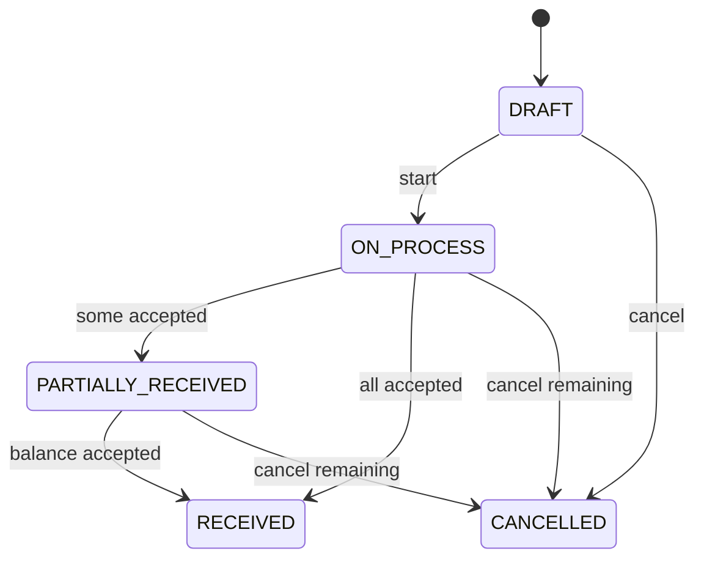
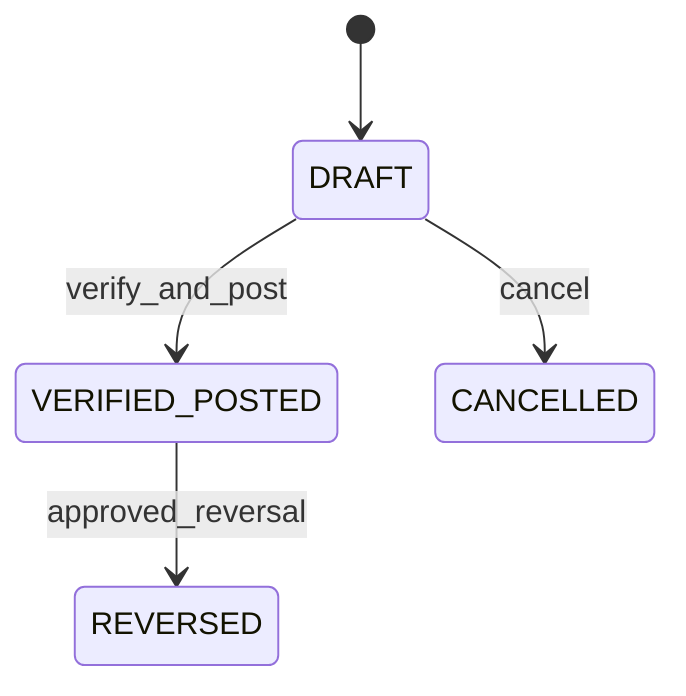
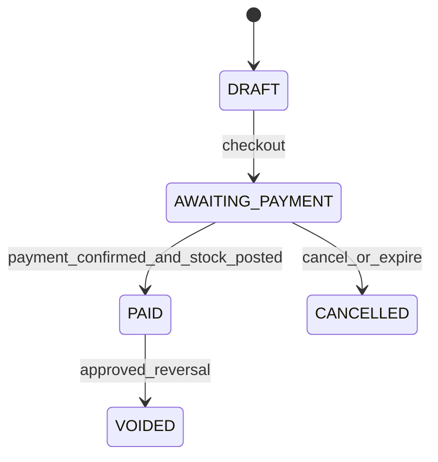
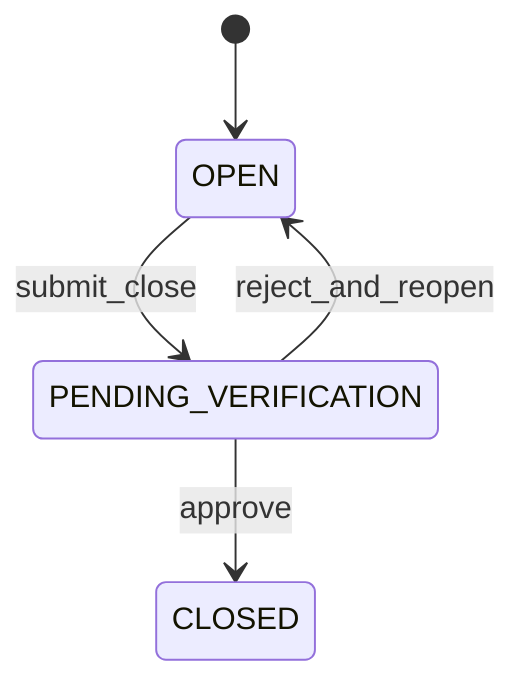

# 15 — Lifecycle, State Transitions & Domain Invariants

Dokumen ini memisahkan workflow agar perubahan status tidak menyebabkan efek stok/kas secara tidak sengaja. Semua aksi final harus tercatat dalam satu transaksi DB jika melibatkan lebih dari satu tabel internal.

## 1. Shopping list

Status `RECEIVED` berarti qty terpenuhi atau remaining ditutup melalui keputusan eksplisit; bila pembelian kurang dari target dan ditutup, simpan variance dan closure reason. Cancel setelah partial receipt tidak membalikkan receipt yang sudah sah. Pemberhentian belanja tidak otomatis membatalkan pembayaran.

## 2. Purchase receipt

Saat `DRAFT`: hanya rencana penerimaan, `stock delta = 0`. Saat `VERIFIED_POSTED`: movement IN dibuat, actor verifier disimpan, cost snapshot immutable. Saat `REVERSED`, dokumen balik menyebabkan movement OUT resmi dengan kontrol stok; tidak menghapus IN asli.

Payment status receipt dihitung dari pembayaran: `UNPAID`, `PARTIALLY_PAID`, `PAID`, dengan reversal/adjustment payment bila ditemukan salah pembayaran. **Jangan gunakan status receiving sebagai payment status.**

## 3. Sale and payment

Payment `PENDING → CONFIRMED | FAILED | CANCELLED`; QRIS confirmed bisa memiliki `settlement_status=UNSETTLED|PARTIALLY_SETTLED|SETTLED` (MVP pencatatan sederhana) yang tidak mengubah sale PAID ketika bank settlement terlambat.

**Invariant:** sale PAID jika dan hanya jika confirmed payment sah menutup total harga dan stock movement OUT lengkap tersedia; operasi ini commit atomik. Jangan `PAID` hanya karena cashier menekan tombol tanpa verifikasi. Void harus membuat reversal stock dan refund/cash movement yang sesuai bukti uang dikembalikan; sale asli tidak dihapus.

## 4. POS session & daily closing

Cashier submit dengan counted cash; Owner/Admin memeriksa expected dan perbedaan. Sesi CLOSED tidak menerima penjualan baru. Setelah audit disetujui, perubahan angka transaksi lama memunculkan adjustment/review note, bukan edit diam-diam.

Daily closing: `DRAFT → SUBMITTED → APPROVED`, dapat `REJECTED → DRAFT` sebelum approval. Post-approval correction memerlukan versi/correction record beralasan; tidak menghapus approved daily close sebelumnya.

## 5. Inventory movement taxonomy

| `movement_kind` | Sign | Source | Pengaruh WAC |
| --- | --- | --- | --- |
| RECEIPT_IN | + | purchase_receipt_item | Hitung ulang WAC |
| SALE_OUT | − | sale_item | Snapshot WAC sebelum keluar |
| OPENING_IN | + | approved opening adjustment | Tetapkan opening cost |
| ADJUSTMENT_IN | + | approved adjustment | Unit cost sesuai kebijakan adjustment |
| ADJUSTMENT_OUT | − | approved adjustment | Kurangi qty dan valuasi dari WAC |
| SALE_VOID_IN | + | sale void/reversal line | Kembalikan berdasarkan cost yang direferensikan; aturan WAC terdokumentasi |
| RECEIPT_REVERSAL_OUT | − | approved receipt reversal | Validasi stok cukup, gunakan aturan cost correction |

Koreksi historis dapat menimbulkan perbedaan penilaian jika barang dari receipt sudah terjual; untuk MVP batasi reversal receipt ketika stok belum cukup dan mintakan adjustment/approval terpisah, jangan menulis ulang cost transaksi sale terdahulu.

## 6. Invariant lintas modul (must never break)

1. Qty on-hand bersumber dari jumlah signed movement posted per produk/store.
2. Tidak ada stock movement dari shopping list atau draft receipt.
3. Satu source event hanya diposting sekali, walau request diulang.
4. Stock on-hand tidak negatif secara default.
5. Sale PAID harus memiliki payment confirmed bernilai tepat dan OUT sesuai seluruh item.
6. Sale AWAITING_PAYMENT/FAILED tidak berkontribusi ke net sales dan tidak OUT permanen.
7. QRIS confirmed bukan bukti settlement bank.
8. Harga jual dan COGS historis tidak dipengaruhi perubahan harga produk.
9. Cash expected tidak memasukkan QRIS; tidak menggandakan sale cash ke cash movement.
10. Purchase receipt stok dan purchase payment tidak harus terjadi bersamaan.
11. Satu stock correction/void membutuhkan reason/permission dan jejak audit.
12. Satu store tidak dapat mengakses transaksi store lain tanpa membership/permission.
13. Semua posting bernilai uang menggunakan integer Rupiah atau presisi fixed-point; tanpa floating-point keuangan.
14. Operation idempotency key sama + payload berbeda harus ditolak.
15. Daily close approved tidak boleh diubah tanpa correction yang terlacak.

## 7. Transaction boundaries

- **Receipt posting transaction:** lock receipt and balance rows → validate status/lines → compute WAC → append movement IN → update balance projection → update receipt status/audit → commit.
- **Sale posting transaction:** lock sale and inventory rows → validate current price/stock, payment proof and session → confirm payment → snapshot price/COGS → append stock OUT → update balances/sale/audit → commit.
- **Void transaction:** validate approver/reason → persist reverse event and stock movement → persist refund/cash out only if money returned → mark sale VOIDED → commit.
- **Session closing:** lock session → recompute expected from posted sources → record counted and variance → submit → separate verifier approval.

## 8. Event naming

`ShoppingListStarted`, `PurchaseReceiptPosted`, `PurchasePaymentRecorded`, `InventoryAdjusted`, `SalePaid`, `SaleVoided`, `CashMovementRecorded`, `POSSessionSubmitted`, `POSSessionClosed`, `DailyClosingApproved`. Event log internal opsional; `audit_logs` dan dokumen sumber tetap wajib. Jika kelak menggunakan event queue, adopsi outbox pattern agar commit dan publish tidak hilang secara terpisah.
